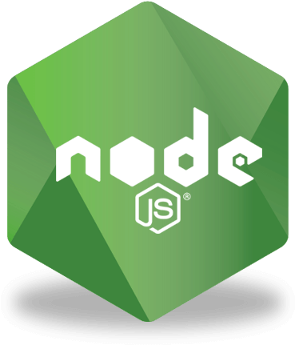
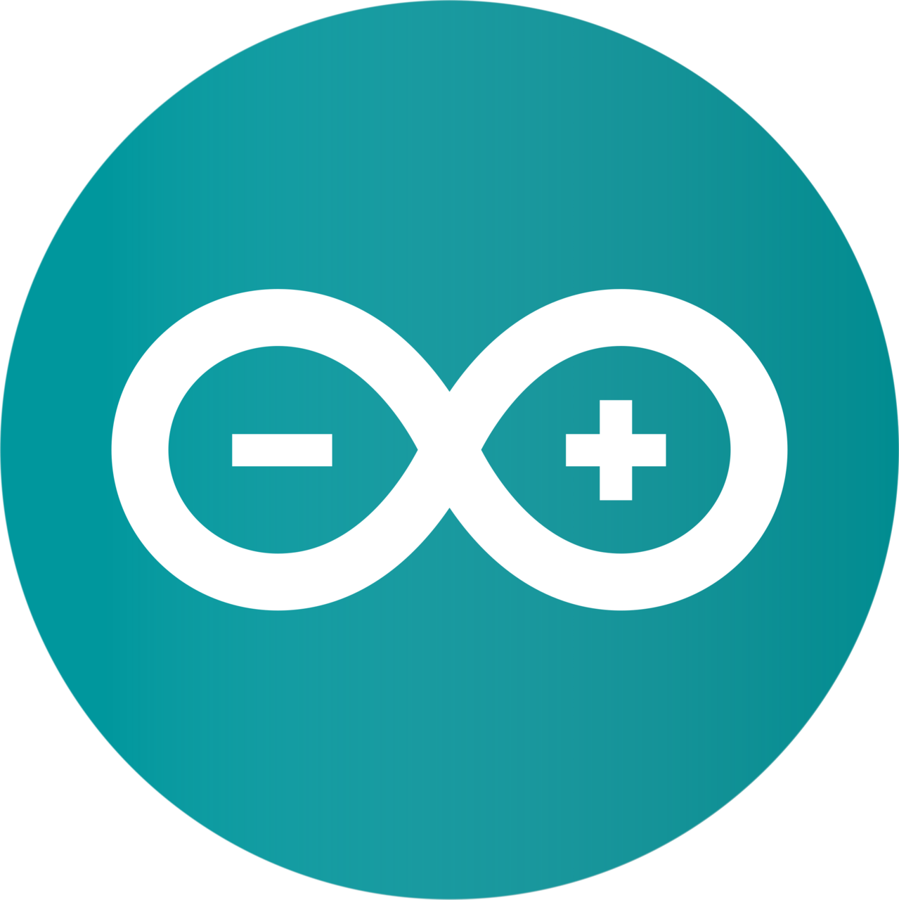
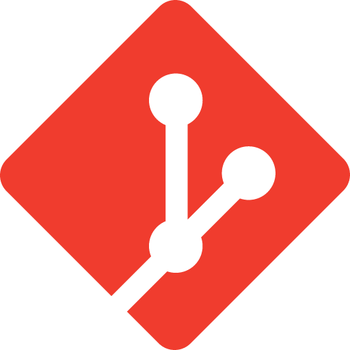
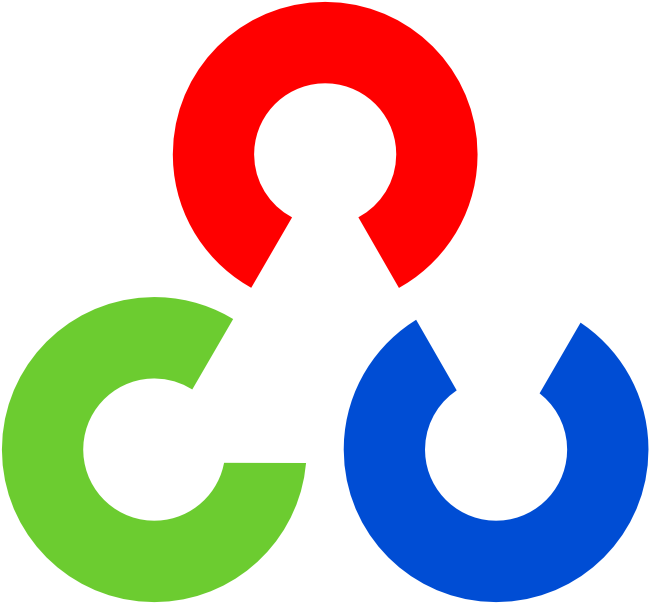

**"code never lies, comments sometimes do"**

# Hey there 
# I'm - Ich bin - Yo soy - Je suis -  [Nico!](https://www.linkedin.com/in/nicolas-arthur-keller/)
 

 

# About me

🎓 Studied Computer Science at the <a href="https://www.unisg.ch/en/">University of St. Gallen</a>

🚧 I'm currently focused on improving my software developing and architecture skills as well as applying those in finance related projects.

👨‍💻 Interested in AI/ML, Software Engineering, Data Analytics, Finance, Markets.

🪂 Among my hobbies are cooking, playing tennis, reading, traveling and listening to music.

# 🧰 My Skills

<code></code>
<code></code>
<code></code>
<code></code>
<code></code>
<code></code>

 

<code></code>
<code></code>
<code></code>
<code></code>
<code></code>
<code></code>

 

<code></code>
<code></code>
<code></code>
<code></code>
<code></code>
<code></code>
<code></code>
<code></code>
<code></code>

 
 

 

 

